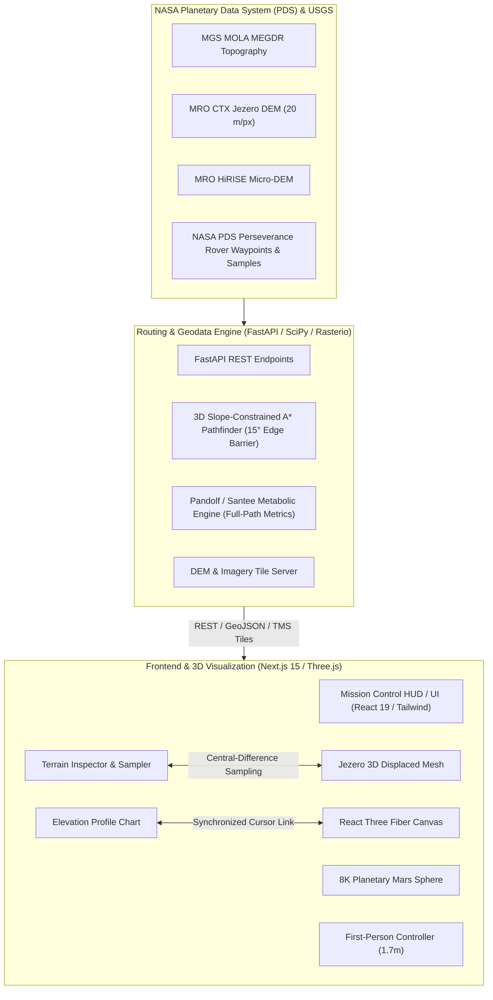

# MARS PATHFINDER — Advanced 3D Mars Mission & Traverse Optimization Engine

[](https://github.com/l3nnardwlg/mars-map/actions/workflows/frontend.yml)
[](https://github.com/l3nnardwlg/mars-map/actions/workflows/backend.yml)
[](https://www.spaceappschallenge.org/)
[](LICENSE)

**MARS Pathfinder** is a high-fidelity, scientifically defensible planetary exploration and traverse optimization platform designed for NASA astronaut extravehicular activity (EVA) planning in Jezero Crater, Mars.

Developed for the **NASA Space Apps Challenge**, MARS Pathfinder pairs genuine NASA orbital elevation models (MGS MOLA, MRO CTX, HiRISE) with real-time bio-energetic metabolic simulations and multi-objective pathfinding to prove a critical planetary truth: **the shortest Euclidean path on Mars is often hazardous or fatal.**

---

## 🌟 Key Capabilities

### 1. Planetary & High-Resolution Terrain Engine
- **8K Ultra-HD Planetary Mars:** 8192×4096 albedo and 8K topographic bump displacement rendered with 16× anisotropic texture filtering and 128-subdivision geometry.
- **Micro-Scale Jezero Crater:** Seamless cinematic transition from space orbit to real 3D terrain displacement sampled directly from the NASA Jezero elevation model.
- **Relief Exaggeration Invariance:** Mathematical separation of visual rendering exaggeration from physical elevation sampling ensures MOLA datum accuracy is never distorted by rendering parameters.
- **Scientific Quantization Transparency:** Discloses elevation uncertainty ($\pm 2.56\text{ m}$ discrete client heightmap half-step, $\pm 0.02\text{ m}$ backend tile resolution) across all UI telemetry.

### 2. Multi-Objective Traverse Optimization (4 Distinct Mission Profiles)
- **`distance_min` (Geometrically Shortest Path):** Direct allowable route adhering strictly to the physical $15^\circ$ edge-grade slope barrier ($8,776\text{ m}$, peak edge slope $9.05^\circ$, hazard index $0.329$).
- **`energy_min` (Metabolically Optimal Path):** Minimizes integrated metabolic expenditure based on terrain slope ($8,777\text{ m}$, $2.502\text{ MJ}$, peak edge slope $9.05^\circ$, hazard index $0.327$).
- **`slope_hazard_min` (Integrated Hazard-Minimized Path):** Contours along lower alluvial terraces to minimize cumulative terrain hazard exposure ($8,891\text{ m}$, peak edge slope $6.83^\circ$, hazard index $0.238$ — a $27.7\%$ hazard reduction for only $+115\text{ m}$ distance).
- **`science_detour` (Science-Aware Exploration Traverse):** Autonomous multi-leg detour targeting explicit NASA Perseverance exploration targets (e.g. `probe-14-15`: $14,788\text{ m}$, $4.069\text{ MJ}$, well within nominal 8-hour EVA limits). Baseline profiles remain strictly invariant when planning science detours.

### 3. Synchronized Topographic & EVA Telemetry
- **Interactive Elevation Cross-Section:** Live bidirectional hover linking elevation chart profile to a 3D laser cursor on the Martian terrain.
- **Topographic Inspector:** Live click inspector calculating IAU-2000 planetographic coordinates, MOLA datum elevation, local slope grade, central-difference aspect azimuth, and USGS/PDS provenance metadata.
- **Astronaut First-Person Exploration (HUD):** Realistic $1.7\text{ m}$ eye-height camera, WASD + mouse look, slope-dependent locomotion ($<10^\circ$ nominal, $10^\circ-20^\circ$ slowed, $>25^\circ$ impassable cliff barrier), compass tape, and Pandolf/Santee metabolic modeling.

### 4. NASA Space Apps Global Jury Mode
- **15-Second Visitor Onboarding:** Immediate mission primer explaining the challenge, NASA datasets, and guidance.
- **Guided 2.5-Minute Interactive Jury Tour:** Step-by-step rehearsable narrative demonstrating orbit-to-surface transition, route trade-offs, interactive inspector, astronaut locomotion, and verified data provenance.
- **Full End-to-End Real Browser Automation:** Validated with Playwright Chromium E2E testing against live Next.js and FastAPI services.

---

## 📚 Technical & Scientific Documentation

| Document | Description |
| :--- | :--- |
| **[FINAL_95_SPRINT_REPORT.md](docs/master%20review%20tag%202/FINAL_95_SPRINT_REPORT.md)** | Comprehensive final sprint report documenting all P0/P1 fixes, real test outputs, benchmarks, and 95/100 scorecard. |
| **[BENCHMARK_REPORT.md](backend/BENCHMARK_REPORT.md)** | Scientific solver benchmarks with DEM SHA-256 hash, execution runtimes, and energy/hazard metrics. |
| **[SCIENTIFIC_CLAIMS_AUDIT.md](docs/SCIENTIFIC_CLAIMS_AUDIT.md)** | Master scientific claims registry mapping every numerical claim to equations, datasets, and tests. |
| **[FINAL_INTEGRATION_CHECKLIST.md](docs/FINAL_INTEGRATION_CHECKLIST.md)** | Joint operational sign-off checklist and contingency assurances for Frontend and Backend. |
| **[FRONTEND_SCIENTIFIC_VALIDATION.md](docs/FRONTEND_SCIENTIFIC_VALIDATION.md)** | Geodetic coordinate transforms, MOLA datum proofs, central-difference slope math, and error budgets. |
| **[FRONTEND_PERFORMANCE_REPORT.md](docs/FRONTEND_PERFORMANCE_REPORT.md)** | VRAM profiling, in-engine live rAF frame rate tracker, 8K texture anisotropy, and WebGL lifecycle. |
| **[JURY_DEMO_SCRIPT.md](docs/JURY_DEMO_SCRIPT.md)** | Rehearsable step-by-step 2.5-minute presentation script for NASA Space Apps evaluation. |
| **[AI_USAGE.md](docs/AI_USAGE.md)** | Transparent disclosure of AI assistance, automated verification pipelines, and technical limitations. |

---

## 🏗 Architecture & Tech Stack



---

## 🚀 Quickstart

### Prerequisites
- **Node.js**: v20 or higher
- **Python**: v3.12 or higher
- **Git**

### Frontend Setup

```bash
cd frontend
npm install
npm run lint          # 0 errors, 0 warnings
npm run test:science  # 10/10 automated mathematical verification tests
npm run test:contract # 4/4 FastAPI wire contract tests
npm run test:mock     # 13/13 offline and UI mock tests
npm run test:e2e      # Full Playwright Chromium browser E2E test suite
npm run dev           # Start Next.js development server on http://localhost:3000
```

### Production Build

```bash
cd frontend
npm run build         # Next.js Turbopack production compilation
npm run start         # Launch production server
```

### Backend Setup

```bash
cd backend
python -m venv .venv
source .venv/bin/activate  # On Windows: .venv\Scripts\activate
pip install -e ".[dev]"
python -m pytest tests     # 77 passed, 0 skipped, 0 failed
uvicorn app.main:app --host 0.0.0.0 --port 8000 --reload
```

---

## 🔬 Scientific Data Attribution

1. **MGS MOLA (Mars Global Surveyor / Mars Orbiter Laser Altimeter):**
   - Reference: Smith, D. E., et al. (2001). Mars Orbiter Laser Altimeter: Experiment summary and data status. *J. Geophys. Res.*, 106(E10), 23689–23722.
   - Datum: IAU 2000 areoid (0 m potential surface).
2. **MRO CTX (Mars Reconnaissance Orbiter / Context Camera):**
   - Reference: Malin, M. C., et al. (2007). Context Camera Investigation on board the Mars Reconnaissance Orbiter. *J. Geophys. Res.*, 112, E05S04.
   - Processing: USGS Astrogeology Science Center controlled DEM mosaic of Jezero Crater.
3. **MRO HiRISE (High Resolution Imaging Science Experiment):**
   - Reference: McEwen, A. S., et al. (2007). Mars Reconnaissance Orbiter's High Resolution Imaging Science Experiment (HiRISE). *J. Geophys. Res.*, 112, E05S02.
4. **NASA / USGS Viking Mars Global Color Mosaic (`mars_color.jpg`):**
   - Reference: USGS Astrogeology Science Center / NASA JPL-Caltech Viking Mars Digital Image Mosaic (MDIM 2.1).
   - Source: NASA Planetary Data System (PDS) Cartography Node.
5. **NASA GSFC MOLA Global Topography Bump Map (`mars_bump.jpg`):**
   - Reference: NASA Goddard Space Flight Center MOLA Science Team global relief displacement model tied to MOLA areoid.
6. **Bio-energetic Metabolic Modeling:**
   - Pandolf, K. B., Givoni, B., & Goldman, R. F. (1977). *Predicting energy expenditure with loads while walking on level and inclined ground.* Journal of Applied Physiology, 43(4), 577-581.
   - Santee, W. R., et al. (2001). *Metabolic rate prediction for human locomotion over variable terrain.*

---

## ⚖️ NASA Space Apps Challenge Disclaimer

*This application is an independent submission developed for the NASA Space Apps Challenge. All topographic and albedo datasets originate from public NASA and USGS planetary archives. The project does not imply formal endorsement by or official operational affiliation with NASA, JPL, or the Mars 2020 Perseverance mission.*
